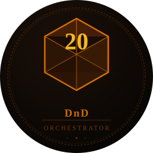
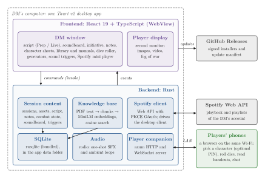

<div align="center">



# DnD Orchestrator

A desktop console for Dungeons & Dragons game masters: an interactive session script, a soundboard
with hotkeys, map projection with fog of war, an initiative tracker, searchable rules manuals and a
phone companion for the players, in a single window.

[](#architecture)
[](#architecture)
[](#architecture)
[](https://github.com/Santi2065/regalo-fio-dnd/releases/latest)
[](LICENSE)

</div>

> It started as a personal gift for Fio and is now open source: use it, fork it, adapt it to your
> own table.

---

## Overview

Running a D&D session usually means juggling a script, a music player, a folder of maps, a
spreadsheet of hit points and a few PDFs. DnD Orchestrator puts all of that in one desktop app
built for the game master:

- **Prep mode**: write the session in Markdown and drop audio and projection *cues* into the text.
- **Live mode**: the script becomes a teleprompter whose cues are buttons that play sounds and put
  images on the players' screen while you narrate.
- **At the table**: initiative, notes, character sheets, a dice roller, random generators and a
  rules search are one shortcut away, and players can follow along from their phones.

Session data is stored locally in SQLite. The interface is in Spanish.

## Features

### Session script

Write the whole session in **Prep** mode using Markdown, and embed cues by dragging assets from the
side panel. In **Live** mode the script turns into an interactive teleprompter: cues become
buttons that trigger sounds and projections.

**Table 1.** Cue syntax.

| Cue | Effect |
|---|---|
| `%%sfx:id:Name%%` | Sound effect (one-shot) |
| `%%ambient:id:Name%%` | Looping ambient music (toggle on/off) |
| `%%project:id:Name%%` | Project an image or video on the second monitor |

### Soundboard and sound triggers

- 16 configurable audio cells. Drag any audio file onto a cell to assign it.
- **Left click** plays it as a sound effect; **right click** edits label, volume, loop mode, hotkey
  and color.
- Per-cell **hotkeys** work from any section of the app, without the soundboard being visible.
- **Sound triggers**: if-then rules that play or stop audio automatically, e.g. when a combatant
  drops below a share of their HP, a given round is reached, a condition is applied, or a given
  image is projected.

### Projection and fog of war

Open a window on the players' monitor and project images or videos with one click. **Fog of
war** reveals the map progressively during the session: paint with the mouse to uncover areas,
with reveal/hide modes and undo.

### Initiative tracker

- List sorted by initiative with an active-turn indicator and a round counter.
- Visual HP bar (green → amber → red by percentage) and quick HP edits with deltas (`+5`, `-12`).
- D&D 5e conditions (Prone, Stunned, Poisoned, Blinded, Frightened and more) plus custom
  conditions per session.
- Player, enemy and NPC combatants; a combatant whose name matches a monster in an imported
  manual shows its **stat block** inline.

### Notes, character sheets and library

- Markdown notes per session with live preview; `Ctrl+S` saves.
- Character sheets from images (jpg, png, webp) or PDFs, in a grid with a side viewer.
- Assets (audio, images, video, sheets) belong to one session or to the **global library**,
  available in every session.

### Rules manuals (knowledge base)

Import PDF manuals into the library and search them from anywhere with `Ctrl+K`. Each page's text
is split into chunks and embedded locally with a multilingual MiniLM model (via fastembed); search
ranks chunks by cosine similarity and falls back to substring matching for chunks without
embeddings. The model is downloaded once (about 120 MB) on first use and cached on disk.

### Improvisation tools

- **Dice roller** (`Ctrl+R`): `1d20+5`, `2d6+3`, advantage/disadvantage, keep highest/lowest
  (`4d6kh3`), several groups in one expression.
- **Generators** (`Ctrl+G`): an NPC, a tavern, loot or the weather in two seconds, from small
  curated lists.

### Player companion

Start the companion and the app serves a mobile web page on the local network, shared by QR code.
Players open it on their phones, pick their character (with an optional session PIN) and can:

- roll dice (the DM sees every roll);
- receive text handouts, sent to one player or to everyone (`Ctrl+M`);
- chat with the DM or with each other.

### Spotify

A mini player at the bottom of the window controls the Spotify desktop client: playback, volume
and a playlist picker with search. Connect your account once from the player and authorize it in
the browser.

### Auto-update

From v1.5 the app checks GitHub Releases on start-up, downloads signed updates in the background
and offers to restart to apply them.

### Keyboard shortcuts

**Table 2.** Shortcuts inside a session.

| Shortcut | Action |
|---|---|
| `Ctrl + 1` / `2` / `3` | Script / Library / Character sheets |
| `Ctrl + 4` / `5` / `6` / `7` | Panel: Sound / Projection / Initiative / Notes |
| `Ctrl + R` | Dice roller |
| `Ctrl + G` | Generators |
| `Ctrl + K` | Search the manuals |
| `Ctrl + M` | Send a handout (with the companion running) |
| `Ctrl + \` | Collapse / expand the right panel |
| `Ctrl + /` | Help |
| `Ctrl + S` | Save the script (Prep mode) or the note being edited |

Soundboard hotkeys are configured per cell and fire from anywhere in the app.

## Architecture

<p align="center"></p>

**Figure 1.** One Tauri v2 app runs on the DM's computer. The React frontend (DM window and
player-display window) calls Rust commands through Tauri's IPC and listens to backend events.
The backend keeps all session data in a local SQLite database, plays audio with rodio, talks to
the Spotify Web API, and runs an embedded HTTP + WebSocket server that the players' phones join
over the local network.

**Table 3.** Stack.

| Layer | Technology |
|---|---|
| Desktop framework | [Tauri v2](https://tauri.app) (Rust + WebView) |
| Frontend | React 19, TypeScript, Tailwind CSS v4, React Router |
| State | Zustand |
| Database | SQLite via rusqlite (bundled) |
| Audio | rodio (mp3, wav, flac, ogg) |
| Manuals | pdf-extract, fastembed (multilingual MiniLM, 384-d embeddings) |
| Player companion | axum (HTTP + WebSocket), QR codes via `qrcode` |
| Spotify | Web API + PKCE OAuth (no SDK; controls the desktop client) |
| Updates | tauri-plugin-updater, signed artifacts on GitHub Releases |
| CI | GitHub Actions: type check + `cargo check` on PRs; release builds on `v*` tags |

**Table 4.** Repository layout.

| Path | Content |
|---|---|
| `src/pages/` | Session list, session dashboard, player display window |
| `src/components/` | Script editor, soundboard, fog painter, initiative tracker, manuals, companion dialogs, UI primitives |
| `src/lib/`, `src/store/` | Cue parser, dice parser, generators, sound-trigger engine; Zustand stores |
| `src-tauri/src/` | Rust modules: `session`, `assets`, `notes`, `guion` (script), `combatants`, `audio`, `display`, `manuals`, `sound_triggers`, `spotify`, `companion`, `db` |
| `src-tauri/src/companion/player_view.html` | The mobile page served to players |
| `assets/` | Audio clips and images for the bundled sample session |
| `docs/UPDATER_SETUP.md` | One-time setup of the updater signing keys (Spanish) |

## Getting started

### Install

**Windows 10 or later.** Download `DnD.Orchestrator_*_x64-setup.exe` (or the `.msi`) from
[Releases](https://github.com/Santi2065/regalo-fio-dnd/releases/latest) and run it. Windows may
show a SmartScreen warning: click **More info → Run anyway**. WebView2 is installed automatically
if missing.

**Linux.** Packages (`.deb`, `.rpm`, AppImage) are published with
[v1.1.0](https://github.com/Santi2065/regalo-fio-dnd/releases/tag/v1.1.0) and earlier; the
latest releases ship Windows installers only, so build from source for the current version.

```bash
sudo dpkg -i DnD.Orchestrator_*_amd64.deb
# or, without installing:
chmod +x DnD.Orchestrator_*.AppImage && ./DnD.Orchestrator_*.AppImage
```

### Build from source

```bash
git clone https://github.com/Santi2065/regalo-fio-dnd.git
cd regalo-fio-dnd
npm install

cp .env.example .env          # set VITE_SPOTIFY_CLIENT_ID from Spotify for Developers

npm run tauri dev             # development, with hot reload
npm run tauri build           # production bundles
```

System dependencies on Debian/Ubuntu:

```bash
sudo apt-get install -y \
  libwebkit2gtk-4.1-dev libappindicator3-dev librsvg2-dev \
  patchelf libssl-dev pkg-config libasound2-dev
```

On Linux, `./dnd-orchestrator.sh` builds a release binary without bundling and starts it with
`WEBKIT_DISABLE_COMPOSITING_MODE=1`.

## Project status

Current version **1.6.0** (May 2026). Development went from a first MVP (script, soundboard,
projection, fog of war, initiative, Spotify) in April 2026 to a second round in May 2026 that
added the knowledge base, the player companion, the dice roller, generators, sound triggers, the
auto-updater and the table chat.

## License

MIT, see [LICENSE](LICENSE).
